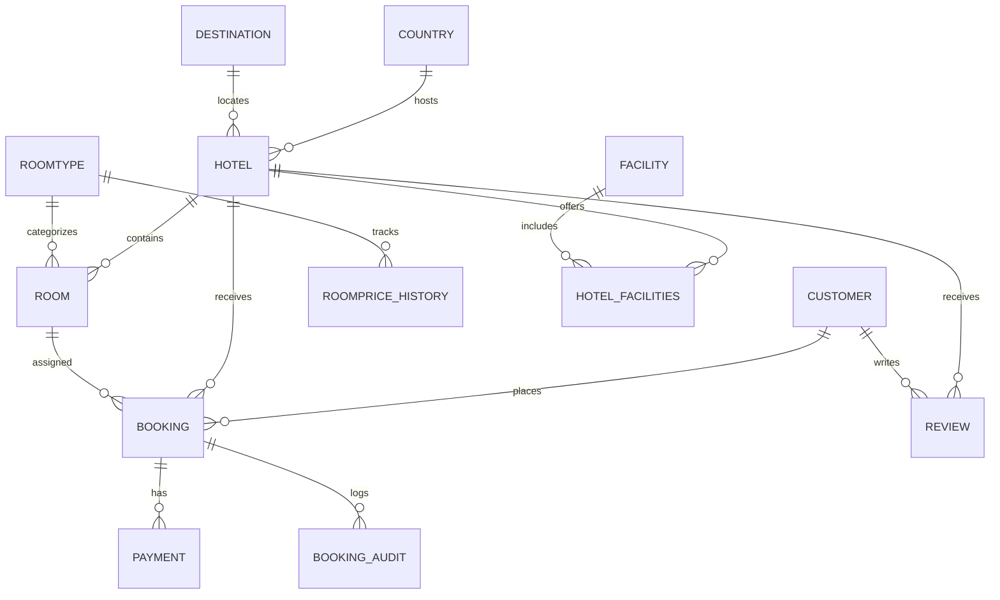

<div align="center">

# Hotel Booking Database · SQL Server

**A relational hotel booking and payments database designed in T-SQL, with migrated surrogate keys and auditable change history**


[Architecture](#architecture) · [Run locally](#quick-start) · [Evolution](#development-migration) · [Testing](#testing-and-verification) · [Documentation](#documentation)

</div>

## Project overview

A **database-only academic project** for modelling hotels, rooms, guests, bookings, payment records, promotions, facilities, policies, currencies, languages and reviews. It is inspired by common online hotel-booking workflows; it is **not** affiliated with Booking.com and is **not** a production hotel booking service.

The public release is based on an actual **SQL Server 2022 schema export** taken **after** the migration of an existing development database. The runnable sample is a clean, new database with *synthetic/anonymized* example records—not an export of real customer data.

## Highlights

- **18 tables** and **19 foreign-key constraints** in the final exported schema.
- **`Booking_ID` and `Payment_ID`** are independent `IDENTITY` primary keys.
- **`Payment.Booking_ID`** is required and references the booking via a trusted foreign key.
- **Booking audit** trigger records `INSERT`, `UPDATE`, `DELETE` for single and multi-row operations.
- **Room price history** trigger records actual price changes (and ignores no-op price updates).
- Check, unique and referential integrity constraints including retained legacy booking uniqueness.
- Reproducible sample seed and rollback-based trigger regression tests.

## Architecture



*Selected conceptual relationships only. Audit and history records deliberately do not need foreign keys to the records that may later be deleted. For every physical column/constraint, see the schema SQL.*

## Quick start

**Required:** Microsoft SQL Server 2022 and SQL Server Management Studio (SSMS). Execute each SQL file **in order** on a non-production server. The target database name is `HotelBookingPortfolioDB`, intentionally different from the original `BookingSystemDB` and `BookingSystemDB_Dev`.

| Order | Script | Purpose |
|---|---|---|
| 1 | [`database/00_Create_Database.sql`](database/00_Create_Database.sql) | Create a fresh empty database; refuses to overwrite one already present |
| 2 | [`database/01_Schema.sql`](database/01_Schema.sql) | Install the **final developed schema** with 18 tables, constraints and 2 triggers |
| 3 | [`database/02_Synthetic_Demo_Data.sql`](database/02_Synthetic_Demo_Data.sql) | **Optional:** add 50 synthetic guests/bookings/payments and supporting lookups |
| 4 | [`database/03_Verify_Database.sql`](database/03_Verify_Database.sql) | Read-only integrity checks and row counts |
| 5 | [`tests/01_Trigger_Regression_Rollback.sql`](tests/01_Trigger_Regression_Rollback.sql) | **Optional:** test booking/price triggers in a transaction and roll back the changes |

**Do not** execute the old `Part1_Database_Schema.sql` or original `02_Inserts.sql` against an existing database—they contain drop/delete/reset logic. The file in `migrations/` is a historical migration **not** a quick-start step.

## Development migration

The original Booking/Payment model used composite identifiers built from customer, room, and check-in date. During development, we migrated to stable primary keys:

| Entity | Original design | Developed design |
|---|---|---|
| Booking | `Customer_ID + Room_ID + CheckInDate` PK | `Booking_ID` identity PK; original triple remains unique |
| Payment | Composite primary key | `Payment_ID` identity PK, `Booking_ID` required FK |
| Booking Audit | Identity of booking inferred from changing business fields | `Booking_ID` stored in audit and used by a set-based trigger |
| Price history | Room type price update audit | Kept; tested actual, unchanged, and multi-row updates |

See [migration details](docs/MIGRATION_NOTES.md) and [the historical one-time SQL migration](migrations/2026_10_30_Final_Keys_Migration.sql). **Do not rerun that migration against an already migrated database.**

## Testing and verification

The user's SSMS development-session results showed: three booking-audit operations (`INSERT`, `UPDATE`, `DELETE`), a three-row booking `UPDATE`, room-price no-change handling, a two-row room-price update, rollback behavior, 50 live bookings and 50 live payments, and a trusted new payment foreign key. These results were observed in that development database, not independently retested on a newly provisioned SQL Server here.

The included SQL verification and regression scripts let someone repeat schema and trigger checks on their own **fresh test database**. The optional demo seed uses placeholder email domains and masked payment identifiers. These demonstration rows are **not the user's live data**.

## Project files

```text
BookingDB_Developed_Full/
├── database/
│   ├── 00_Create_Database.sql
│   ├── 01_Schema.sql
│   ├── 02_Synthetic_Demo_Data.sql
│   └── 03_Verify_Database.sql
├── migrations/
│   └── 2026_10_30_Final_Keys_Migration.sql
├── tests/
│   └── 01_Trigger_Regression_Rollback.sql
├── docs/
│   ├── Original_Project_Report.pdf
│   ├── Original_UML_Diagram.png
│   ├── Original_Additional_Diagram.png
│   └── MIGRATION_NOTES.md
├── .gitignore
└── README.md
```

## Documentation

- [Original academic project report](docs/Original_Project_Report.pdf)
- [Original UML/database diagram](docs/Original_UML_Diagram.png)
- [Additional original diagram](docs/Original_Additional_Diagram.png)
- [Details of the changes made during development](docs/MIGRATION_NOTES.md)

*The academic report/diagrams are preserved as submitted and may reflect the original composite-key design. The current code and conceptual architecture above reflect the developed version.*

## Privacy and limitations

This repository intentionally omits live exports, SQL backups (`.bak`), `.mdf/.ldf` files, and real customer/payment details. The final schema itself is based on the provided SSMS export. **The current public release has not yet been clean-room tested on a fresh SQL Server instance**; validation is the next step before promoting it as fully reproducible. The project is a database backend model, not a complete application or official Booking.com integration.
